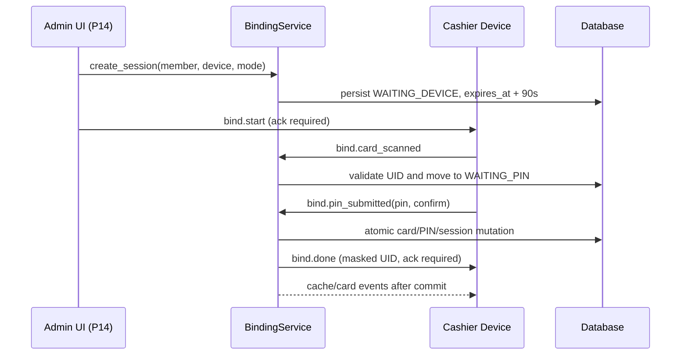

# Architecture

## Balance mutation pipeline

All balance mutations follow one atomic path:

1. A domain service starts one database transaction.
2. `LedgerService._debit_internal()`, `_credit_internal()`, or `_reverse_internal()` applies the integer-Rupiah balance mutation and writes its ledger row.
3. The ledger service calls `_refresh_allowances(member_id)` before the transaction commits.
4. `AllowanceService.apply_allowances()` recalculates cache membership and per-device offline allowances, flushes those rows, and appends a `CacheUpdateEvent` to `session.info["mgt_pending_events"]`.
5. SQLAlchemy's `Session.after_commit` listener publishes queued events through the in-process `EventBus` only after a successful commit.
6. P10 may subscribe a WebSocket bridge to the event bus. No WebSocket subscriber is part of P9.

A matching `Session.after_rollback` listener discards pending events. This prevents a session reused after rollback from publishing stale cache snapshots on a later commit.

## Offline member cache and allowance

Each active offline-capable device caches up to 100 members. The first positions are ordered by completed PAYMENT count on that device during the previous 60 days, then most recent payment timestamp. Remaining positions are filled by most recent completed PAYMENT on any device. Only ACTIVE members with an ACTIVE card are eligible.

For a member, N is the number of offline-capable device caches that include that member. Each included device receives `min(offline_card_cap, floor(member.balance / N))`. This keeps the sum of allowances at or below the member's balance.

In `offline_hold_mode=soft`, online payments may spend the full balance. In `hard`, the spendable online balance is `member.balance - sum(offline_allowances.amount)`; PaymentService checks this before every online debit, and admin top-up reversal checks it before its debit.

## WebSocket layer (P10)

The authenticated device transport is mounted at `/ws/device`, separately from REST routers. The device sends its token inside the first hello envelope. The connection manager enforces one socket per device and persists online/offline state and device events. Each database operation uses a short-lived SessionLocal session; no SQLAlchemy session is held for the socket lifetime. Committed domain events are bridged to an asyncio queue and broadcast to connected devices. Heartbeat defaults are 10-second ping target, 25-second pong timeout, and 30-second idle disconnect. Offline alerts are best-effort and controlled by ALERT_WEBHOOK_URL.

## Remote card binding (P11)

Binding supports NEW_CARD, REPLACE_CARD, and PIN_ONLY. The service owns the transactional state machine; P11 adds no admin router. P14 will expose the future `POST /admin/bind-sessions` endpoint.
