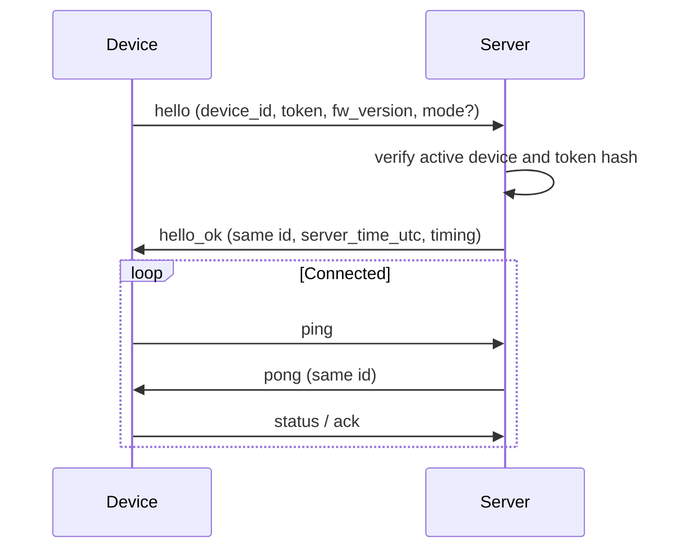
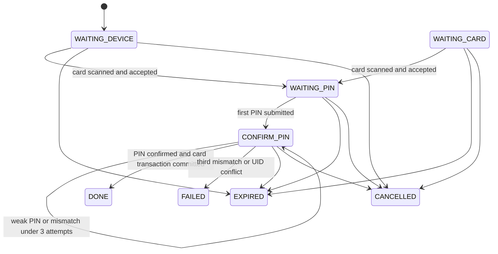

# Device WebSocket Protocol

Endpoint: `/ws/device` (WebSocket; not a REST endpoint). Device credentials are sent only in the first `hello` envelope body, never in the URL.

## Envelope

Every message in both directions uses `{ "v": 1, "id": "<uuid>", "type": "...", "ts": 1793966400, "data": {} }`. `ts` is Unix epoch seconds; persisted and ISO timestamps are UTC. Message IDs correlate replies and acknowledgements.

## Handshake



## Message types

| Direction | Type | Data |
|---|---|---|
| Device → Server | hello | device_id, token, fw_version, optional cashier mode |
| Server → Device | hello_ok | device_id, server_time_utc, ping_interval_s=10, pong_timeout_s=25, idle_disconnect_s=30 |
| Both | ping / pong | pong includes server_time_utc |
| Both | ack | id of acknowledged server envelope |
| Device → Server | status | state: idle or busy |
| Server → Device | bind.start | P11 payload; reserved in P10 |
| Device → Server | bind.card_scanned, bind.pin_submitted, bind.cancel | P11 payload; reserved in P10 |
| Server → Device | bind.error, bind.done, bind.cancel | P11 payload; reserved in P10 |
| Server → Device | catalog.changed | version |
| Server → Device | cache.invalidate | uid_list or all |
| Server → Device | cache.update | uid, balance_snapshot, offline_allowance, card_status |
| Server → Device | card.status_changed | uid, status |
| Server → Device | config.changed | keys |
| Server → Device | force_disconnect | reason |

Heartbeat: devices should ping every 10 seconds; pong timeout is 25 seconds. No inbound message for 30 seconds closes the socket.

## Close codes

| Code | Meaning |
|---:|---|
| 4001 | Replaced by a newer connection |
| 4002 | Hello required or invalid handshake |
| 4003 | Unauthorized or revoked device |
| 4004 | bind.* received before P11 support |
| 4005 | Idle timeout |
| 4006 | Heartbeat timeout |

P10 implements handshake, ping/pong, status, and committed cache/card event broadcast. Binding handlers are intentionally deferred to P11.


## Remote card binding (P11)

| Direction | Type | Data |
|---|---|---|
| Server → Device | bind.start | session_uuid, member_name, mode, timeout_s |
| Device → Server | bind.card_scanned | session_uuid, uid, ts |
| Device → Server | bind.pin_submitted | session_uuid, pin, confirm, ts |
| Server → Device | bind.error | session_uuid, code, message |
| Server → Device | bind.done | session_uuid, uid_masked, status |
| Both | bind.cancel | session_uuid, reason |

Every server binding command is acknowledged by a device `ack` envelope whose `data.id` equals the command envelope ID. The default acknowledgement deadline is 5 seconds; a timeout is logged and does not roll back a successful binding state transition.

```json
{
  "v": 1,
  "id": "4c9b70ec-4c11-4d44-a6c8-4c00b7b4a821",
  "type": "bind.pin_submitted",
  "ts": 1793966400,
  "data": {
    "session_uuid": "b0f8e2c5-7d1d-47f1-9e17-5b1ef5f8f84b",
    "pin": "4610",
    "confirm": "4610",
    "ts": 1793966400
  }
}
```

### Binding state machine



The server stores only a peppered HMAC candidate hash during PIN confirmation, never the plaintext candidate. A successful `bind.done` masks the UID as four bullets followed by its last four characters.


P11 supersedes the P10 pre-binding behavior: supported `bind.*` messages are handled by the binding state machine; unknown `bind.*` messages are logged and ignored. Close code 4004 remains documented as the legacy pre-P11 unsupported-binding close code and is not used for supported P11 flows.
